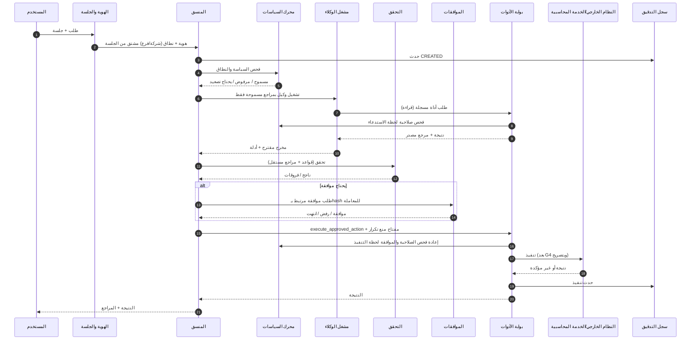

# 03 — المعمارية التفصيلية (منطقية)

**الحالة:** DESIGN_DRAFT. كل ما هنا PROPOSED. **لا ارتباط بمزود سحابة أو تقنية** قبل حسم ADR-003 وADR-004.
قسم «بدائل تقنية» ذكر لأنواع الحلول لا لتوصية بمنتج بعينه.

## 1. مبادئ حاكمة (من قرارات المالك USER-APPROVED)
1. الوكيل يقترح ولا يعتمد ولا ينفذ مباشرة.
2. لا كتابة غير مقيدة من طبقة الذكاء الاصطناعي إلى الأستاذ العام.
3. العزل يُفرض في الخادم وطبقة البيانات، لا في الواجهة.
4. كل نتيجة تُربط بمصدر ودليل.
5. فشل مكوّن رقابي = توقف آمن (fail-closed) لا تجاوز.

## 2. مخطط تدفق الطلب

## 3. المكونات الستة عشر

الصيغة: **المسؤولية · يقرأ/يكتب · الصلاحية · الفشل والمراقبة · الاختبار · بدائل (أنواع)**.

| # | المكوّن | المسؤولية | يقرأ / يكتب | الصلاحيات | حالات الفشل والمراقبة | اختبارات أساسية | أنواع البدائل |
|---|---|---|---|---|---|---|---|
| 1 | واجهة المستخدم | عرض المهام والنتائج والأدلة وطلبات الموافقة | يقرأ عبر API فقط | لا تحمل قرار صلاحية | إخفاء الزر لا يكفي. خطأ العرض لا يغير الحالة | صلاحيات من الخادم رغم تلاعب الواجهة | ويب RTL |
| 2 | الهوية والجلسات | مصادقة، MFA، انتهاء الجلسة، اشتقاق النطاق | هوية المستخدم / جلسات | مسؤول الهوية فقط | تعذر الهوية = رفض. مراقبة الدخول الفاشل | سرقة جلسة، تعدد أجهزة | SSO مؤسسي أو مزود هوية مُدار |
| 3 | إدارة المؤسسات والشركات والفروع | سجل الكيانات وعضوية المستخدمين | يقرأ ويكتب الكيانات | مسؤول المؤسسة | تعديل نطاق = حدث تدقيق | عبور شركة لأخرى | حسب ADR-002 |
| 4 | محرك تنسيق المهام | تقسيم المهمة، اختيار الوكيل، جمع النتائج، كشف التعارض | يكتب حالة المهمة | هوية خدمة بأقل صلاحية | طلب عالق = مهلة وتصعيد | استئناف بعد توقف | محرك workflow دائم |
| 5 | سجل حالات المهام | حالة دائمة لا تعتمد على الجلسة | يكتب الحالة | المنسق فقط | تعارض كتابة = قفل تفاؤلي | سباق حالتين | قاعدة علاقية |
| 6 | تشغيل الوكلاء وإصداراتهم | تشغيل وكيل بإصدار ثابت وتعليمات ومراجع | يقرأ تعريف الوكيل | لا يغير سياسته | مهلة، حد رموز | تثبيت الإصدار | عزل تشغيل |
| 7 | محرك السياسات والصلاحيات | قرار السماح (RBAC + سمات النطاق + حالة الموافقة) | يقرأ السياسات | إدارة السياسات لأدوار محددة وليس الوكيل | عطل = رفض | تغيير السياسة بالسماح | محرك سياسات منفصل عن التطبيق |
| 8 | بوابة تنفيذ الأدوات | المنفذ الوحيد للأدوات (انظر 07) | يقرأ سجل الأدوات | فحص لحظة التنفيذ | غموض النتيجة = حالة UNCERTAIN | حقن معاملات | — |
| 9 | الموافقات البشرية | إنشاء الطلب وربطه بنسخة المعاملة والتوقيت | يكتب القرار | المعتمد ≠ المنشئ | انتهاء الصلاحية، تعطل الخدمة = توقف آمن | تغيير الحقول بعد الموافقة | — |
| 10 | البيانات والمستندات | تخزين المصدر والأدلة بتصنيف وعزل | يقرأ/يكتب | حسب النطاق والتصنيف | فساد، تكرار | سلامة الـhash | مخزن كائنات + علاقية |
| 11 | التكاملات الخارجية | موصلات بقراءة افتراضيًا | أسرار من خزنة | هوية خدمة منفصلة لكل موصل | مهلة، حد معدل | موصل وهمي | — |
| 12 | سجل التدقيق والأحداث | سجل إلحاقي لكل إجراء حساس | يكتب فقط | قراءة لأدوار التدقيق | فشل التسجيل = إيقاف الإجراء الحساس | عدم القابلية للتعديل | تخزين إلحاقي |
| 13 | المراقبة والتنبيهات | مقاييس وتنبيهات تشغيلية وأمنية | يقرأ مقاييس | بلا بيانات حساسة في السجلات | تنبيه مفقود | اختبار التنبيه | — |
| 14 | التكلفة والحصص | حد رموز/تكلفة لكل شركة ووكيل | يكتب عدادات | — | تجاوز = إيقاف أو تصعيد | استنزاف | — |
| 15 | النسخ والتعافي | نسخ واستعادة حسب ADR-010 | — | مفصول | استعادة فاشلة | تمرين استعادة موثق | — |
| 16 | الإصدارات والتكوينات | إصدارات الوكلاء والسياسات والأدوات | يكتب نسخ ثابتة | موافقة تغيير | تغيير بلا موافقة | تراجع | — |

## 4. فصل الطبقات
- **مستوى التحكم:** السياسات، الهويات، الإصدارات (تغييره بموافقة ومراجعة).
- **مستوى التشغيل:** المهام، الوكلاء، الأدوات.
- **مستوى الأدلة:** السجل الإلحاقي والمستندات المصدرية، مفصول عن بيانات التشغيل.

## 5. نقاط تحتاج قرارًا قبل التفصيل
تقنية الهوية، نمط العزل (ADR-002)، موقع النماذج (ADR-004)، تخزين الأدلة (ADR-003/009).
