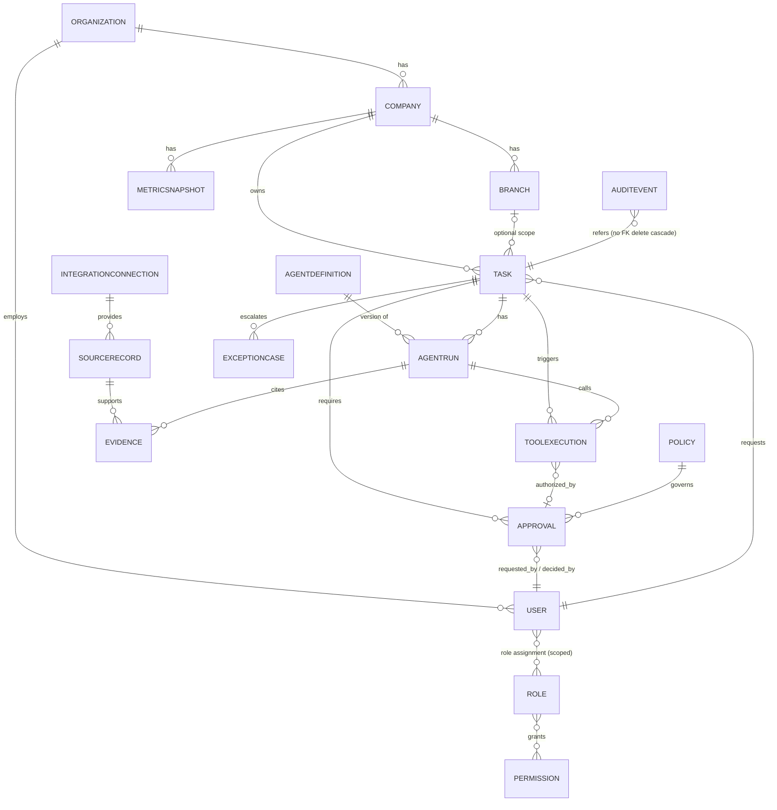

# 04 — نموذج البيانات والعزل (ERD)

**الحالة:** DESIGN_DRAFT. نموذج أولي PROPOSED وليس مخططًا نهائيًا. لا أنواع بيانات ولا أسماء جداول نهائية.

## 1. قيود لا يمكن تثبيتها الآن (BLOCKED)
| القيد | يعتمد على |
|---|---|
| آلية العزل (معرف مشترك / schema / قاعدة لكل شركة) | ADR-002 |
| مدد الاحتفاظ ومستويات التصنيف | ADR-009, ADR-014 |
| حقول SourceRecord الفعلية | ADR-005, ADR-008 |
| مكان التخزين والتشفير | ADR-003 |
| تعريف الحقول «الجوهرية» للمعاملة | مالك كل عملية (06 §3) |

## 2. مخطط ERD

`AUDITEVENT` مخزن منفصل إلحاقي (انظر §4). علاقته بالمهمة مرجعية لا تتسلسل بالحذف.

## 3. الكيانات (الصيغة: الغرض · المعرف · الحقول الأساسية · القيود · النطاق · الاحتفاظ/الحساسية · الحذف)

الاحتفاظ والحساسية = UNKNOWN حتى ADR-009. كل الكيانات تشغيلية تحمل `company_id` إلا ما نُص عليه.

| الكيان | الغرض | الحقول الأساسية (مقترحة) | التفرد والتحقق | الحذف/التعديل |
|---|---|---|---|---|
| Organization | جذر المؤسسة | id, name, status | name فريد | تعطيل لا حذف |
| Company | شركة ضمن المؤسسة | id, org_id, legal_name, status | (org_id, code) فريد | تعطيل لا حذف |
| Branch | فرع | id, company_id, code, status | (company_id, code) فريد | تعطيل لا حذف |
| User | مستخدم | id, org_id, external_identity_ref, status | معرف الهوية فريد | **تعطيل** فقط، السجلات تبقى مرتبطة بالمعرف |
| Role | دور | id, name, scope_type | الاسم فريد في النطاق | نسخ ثابتة، لا حذف حين يُستخدم |
| Permission | قدرة (C1..C10) على نوع مورد | id, capability, resource_type | (capability, resource_type) فريد | ثابت |
| Policy | قاعدة ضبط | id, version, content_hash, status | version فريد، **ثابت بعد النشر** | نسخة جديدة بدل التعديل |
| AgentDefinition | تعريف وكيل بإصدار | id, version, instructions_hash, allowed_tools, risk_level | (name, version) فريد، ثابت | نسخة جديدة، تعطيل ممكن |
| AgentRun | تشغيل وكيل | id, task_id, agent_def_id+version, model_provider/version, started/ended, status, cost | مرتبط بمهمة وإصدار | إلحاقي |
| Task | مهمة | id, company_id, branch_id?, requested_by, type, state, idempotency_key | (company_id, idempotency_key) فريد | تتغير الحالة فقط عبر انتقالات `07` |
| Approval | طلب موافقة | id, task_id, payload_hash, requested_by, decided_by, decision, reason, expires_at, consumed_at | decided_by ≠ requested_by عند الاشتراط، وpayload_hash مطلوب | قرار نهائي ثابت |
| ToolExecution | استدعاء أداة | id, task_id, run_id, tool_name+version, input_hash, idempotency_key, result_status, approval_id? | (tool, idempotency_key) فريد | إلحاقي |
| SourceRecord | سجل من نظام مصدر | id, connection_id, external_ref, fetched_at, content_hash | (connection_id, external_ref, content_hash) فريد | ثابت، لا تعديل |
| Evidence | ربط نتيجة بدليل | id, source_record_id, run_id, locator | مرجعية سليمة إلزامية | ثابت |
| AuditEvent | حدث تدقيق | id, ts, actor, company_id, action, object_ref, before/after_hash, prev_hash | تسلسل hash | **إلحاقي فقط** |
| IntegrationConnection | وصلة نظام خارجي | id, company_id, system_ref, secret_ref | **لا أسرار داخل السجل، مرجع للخزنة فقط** | تعطيل |
| ExceptionCase | حالة استثناء | id, task_id, severity, owner, status | — | الحالة تتغير، التاريخ يبقى |
| MetricSnapshot | لقطة مؤشرات | id, company_id, period, metric, value, source_ref | (company, period, metric, version) | لقطات ثابتة، التصحيح بلقطة جديدة |

## 4. ضوابط العزل والتدقيق (ملزمة)
1. `company_id` (و`branch_id` عند الانطباق) يُشتق من الجلسة، ولا يُقبل من جسم الطلب.
2. يُفرض النطاق في الخادم **وفي** طبقة البيانات (طريقة التنفيذ تتبع ADR-002).
3. أي استعلام عابر للشركات ممنوع إلا لدور إشرافي موثق، ويسجل.
4. بيانات التشغيل مفصولة عن `AuditEvent` (مخزن وصلاحيات مختلفة).
5. التصحيح: بحدث تصحيحي جديد يشير للقديم. لا حذف ولا تعديل لسجل رقابي.
6. تعطيل المستخدم: لا يحذف سجلاته، ويبقى المعرف في الأحداث.
7. لا أسرار في `Task` أو `ToolExecution` أو سجلات التطبيق، ويحفظ hash للمدخلات حيث لا يجوز حفظ المحتوى.
8. بيانات HR (ADR-014) في نطاق مصنف منفصل.

## 5. فهارس مقترحة (تُراجع بعد تحديد التقنية)
`(company_id, state, created_at)` على Task · `(task_id)` على الأبناء · `(payload_hash)` على Approval · `(tool_name, idempotency_key)` · `(company_id, ts)` على AuditEvent.

## 6. معايير قبول مستقبلية
- اختبار: مستخدم شركة A لا يقرأ ولا يكتب في B ولو غيّر المعرف في الطلب.
- اختبار: لا مسار حذف/تعديل على AuditEvent من التطبيق.
- اختبار: تعطيل مستخدم يحفظ كل سجلاته.
