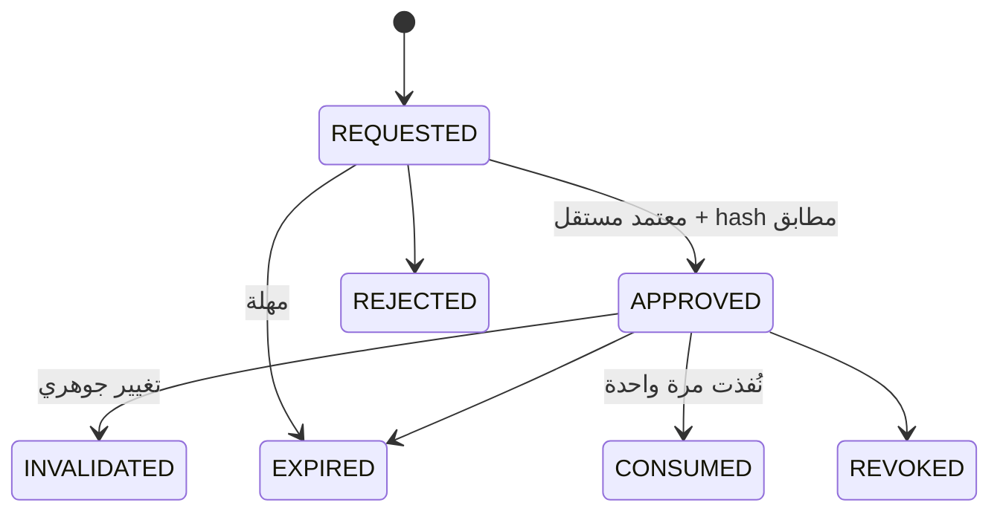

# 06 — الصلاحيات (RBAC/ABAC) والموافقات

**الحالة:** DESIGN_DRAFT. الإطار PROPOSED. **الأدوار الفعلية وحدود المبالغ UNKNOWN** (ADR-007) ولم تُخترع. ما يُذكر باسم «دور» أدناه نوع دور وظيفي مقترح، لا منصب موجود.

## 1. قدرات منفصلة (Capabilities)
لكل قدرة صلاحية مستقلة لا تستلزم غيرها:

| الرمز | القدرة | ملاحظة |
|---|---|---|
| C1 | قراءة | ضمن النطاق والتصنيف |
| C2 | تحليل | حساب دون أثر |
| C3 | إعداد مسودة | لا أثر خارجي |
| C4 | طلب موافقة | |
| C5 | اعتماد | لا يجتمع مع C4 على المعاملة نفسها حين تفرض السياسة الفصل |
| C6 | تنفيذ | عبر بوابة الأدوات فقط |
| C7 | مراجعة | مستقلة عن الإنشاء والاعتماد |
| C8 | إدارة السياسات | لا يملكها أي وكيل |
| C9 | إدارة الوكلاء والأدوات | نشر إصدار / تعطيل |
| C10 | الاطلاع على سجل التدقيق | قراءة فقط |

## 2. قواعد النطاق (ABAC)
قرار السماح = دور ∧ سمات: `company_id`, `branch_id`, `data_classification`, `task_type`, `risk_level`.
- النطاق يُشتق من الجلسة والمهمة، **لا من حقول الطلب**. أي معرف شركة/فرع في الطلب يُقارن بالنطاق ولا يُصدَّق.
- تُطبَّق نفس القاعدة في الخادم وفي طبقة البيانات.

## 3. قواعد الموافقة (ملزمة، من النص الأصلي)
1. لا يعتمد المنشئ (شخصًا أو وكيلًا) إجراءه عند اشتراط الفصل.
2. الموافقة مرتبطة بمحتوى المعاملة وإصدارها (hash).
3. تغيير أي حقل جوهري بعد الموافقة يبطلها ويستلزم إعادة التحقق.
4. لا تنفيذ بعد انتهاء الصلاحية أو الإلغاء.
5. الصلاحية تُراجع لحظة التنفيذ.
6. يُوثَّق: طالب الموافقة، المعتمد، الوقت، السبب.
7. الوكيل لا يغير السياسة التي تحكمه.
8. الإجراءات المالية الحساسة وHR والعمليات الخارجية لها ضوابط يحددها مالك العملية.
9. تعطيل وكيل أو أداة ممكن دون تعطيل تسجيل الحادث.
10. تعطل خدمة الموافقات = توقف آمن لا تجاوز.

**ما هو «جوهري»** لكل نوع معاملة (مبلغ، طرف، حساب، تاريخ…): UNKNOWN، يحدده مالك العملية.

## 4. جدول الإجراءات

مستوى الخطورة هنا تصنيف مقترح أولي. الحدود الرقمية UNKNOWN.

| الإجراء | الخطورة | المنشئ المسموح | المعتمد | شروط التنفيذ | التصعيد |
|---|---|---|---|---|---|
| قراءة تقرير ضمن النطاق | منخفضة | مستخدم/وكيل ضمن نطاقه | لا يلزم | فحص نطاق وتصنيف | رفض + تسجيل |
| تحليل (نسب، شذوذ) | منخفضة | وكيل | لا يلزم | مصادر موثقة | فروقات تُعرض ولا تُخفى |
| إعداد مسودة قيد | متوسطة | الوكيل المالي (مسودة فقط) | مراجع محاسبي (دور يحدده المالك) | لا ترحيل | عدم توازن = إيقاف وتصعيد |
| ترحيل قيد | عالية | بشري/خدمة محاسبية معتمدة | معتمد ≠ المنشئ | موافقة صالحة، فترة مفتوحة، منع تكرار | تأخر الموافقة = انتظار لا تجاوز |
| تغيير بيانات مورد/بنك | عالية جدًا | بشري فقط | اثنان مستقلان (مقترح) | تحقق خارج القناة | الوكيل **ممنوع** |
| طلب شراء / مطابقة | متوسطة | وكيل المشتريات (اقتراح) | مالك الميزانية | فروقات موثقة | استثناء → مالك العملية |
| إجراء HR على موظف | عالية جدًا | بشري فقط | حسب سياسة HR | بيانات الموظف مقيدة | الوكيل **ممنوع** من قرار وظيفي |
| نشر إصدار وكيل/أداة | عالية | مسؤول الوكلاء | مراجع مستقل | اختبارات قبول ناجحة | رفض النشر |
| تغيير سياسة | عالية جدًا | مسؤول سياسات بشري | مراجع مستقل | سجل تغيير | الوكيل **ممنوع** |
| تعطيل وكيل/أداة (kill switch) | حرجة | مسؤول أمن/تشغيل | لا يلزم قبل التنفيذ | يسجل الحادث | مراجعة لاحقة |

## 5. دورة حياة الموافقة

الموافقة **تستهلك** عند التنفيذ ولا تُعاد استعمالها.

## 6. معايير قبول (مستقبلية، غير محققة)
- لا مسار يتيح تنفيذًا دون موافقة صالحة حين تُشترط.
- تغيير حقل جوهري بعد الموافقة يُرفض في اختبار.
- إسقاط خدمة الموافقات يوقف التنفيذ ولا يتجاوزه.
- المنشئ لا يستطيع اعتماد معاملته.

## 7. المطلوب من المالك
قائمة الأدوار والمناصب · سياسة التفويض الحالية · الحدود المالية · تعريف «الجوهري» لكل معاملة · من يملك kill switch.
