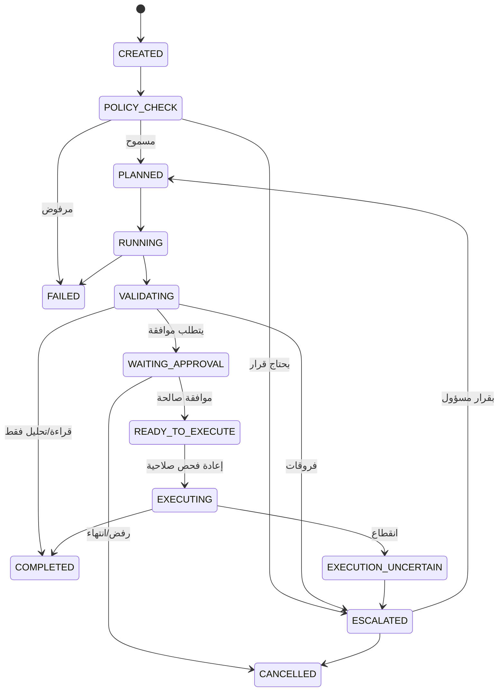

# 07 — دورة المهام وبوابة الأدوات

**الحالة:** DESIGN_DRAFT. كل الحالات والأدوات PROPOSED. أسماء الأدوات أمثلة تصميمية لا تدل على وجود أنظمة.

## 1. حالات المهمة (مقترحة)
`CREATED → POLICY_CHECK → PLANNED → RUNNING → VALIDATING → WAITING_APPROVAL → READY_TO_EXECUTE → EXECUTING → COMPLETED`
وحالات جانبية: `ESCALATED`, `FAILED`, `CANCELLED`.
إضافة مقترحة: **`EXECUTION_UNCERTAIN`** لحالة انقطاع الاتصال أثناء التنفيذ ولا يُعرف أثره (تحتاج مراجعة قبل الاعتماد).

## 2. جدول الانتقالات

| من → إلى | الشرط | الجهة المجيزة | البيانات المطلوبة | حدث التدقيق | إعادة المحاولة | أثر خارجي | منع التكرار |
|---|---|---|---|---|---|---|---|
| CREATED → POLICY_CHECK | طلب صحيح | المنسق | هوية، نطاق من الجلسة | `task.created` | نعم | لا | معرف طلب فريد |
| POLICY_CHECK → PLANNED | السياسة تسمح | محرك السياسات | قرار + نسخة السياسة | `policy.allowed` | نعم | لا | — |
| PLANNED → RUNNING | وكيل بإصدار ثابت | المنسق | إصدار الوكيل والمراجع | `agent.run.started` | نعم (قراءة) | لا | معرف تشغيل |
| RUNNING → VALIDATING | مخرج بمخطط صحيح | المنسق | مخرج + أدلة | `agent.run.completed` | — | لا | — |
| VALIDATING → WAITING_APPROVAL | إجراء يتطلب موافقة | المنسق | hash المعاملة | `approval.requested` | — | لا | طلب لكل hash |
| WAITING_APPROVAL → READY_TO_EXECUTE | موافقة صالحة غير منتهية | الموافقات | معتمد ≠ منشئ | `approval.granted` | — | لا | استهلاك الموافقة مرة |
| READY_TO_EXECUTE → EXECUTING | إعادة فحص الصلاحية والـhash | بوابة الأدوات | مفتاح idempotency | `execution.started` | **لا تلقائيًا** | **نعم** | المفتاح + حجز |
| EXECUTING → COMPLETED | نتيجة مؤكدة | البوابة | استجابة النظام | `execution.completed` | — | نعم | — |
| EXECUTING → EXECUTION_UNCERTAIN | انقطاع/مهلة بلا تأكيد | البوابة | آخر حالة معروفة | `execution.uncertain` | **ممنوع حتى التحقق** | محتمل | يُسأل النظام الهدف بالمفتاح |
| أي → FAILED | خطأ غير قابل للاستئناف | المنسق | سبب | `task.failed` | حسب النوع | حسب المرحلة | — |
| أي → CANCELLED | طلب إلغاء مصرح | المستخدم/المسؤول | سبب | `task.cancelled` | — | لا إن لم يبدأ التنفيذ | — |

## 3. المهل وإعادة المحاولة (سياسة مقترحة)
- **قراءة بلا أثر:** إعادة محاولة تلقائية محدودة مع تراجع أسي (الأرقام تحدد لاحقًا).
- **كتابة/أثر خارجي:** لا إعادة تلقائية قبل التحقق من حالة الهدف بمفتاح idempotency.
- **الحد الأقصى للمدة** لكل حالة، وعند التجاوز: تصعيد لا إهمال.
- **الاستئناف:** الحالة دائمة في سجل المهام. التنفيذ لا يعتمد على جلسة المستخدم، والعامل الجديد يعيد التحقق من الصلاحية والموافقة قبل المتابعة.
- **المهام المعلقة** في `EXECUTION_UNCERTAIN`: لا تُنفذ ثانية، تُصعَّد لمالك العملية مع مفتاح المطابقة.

## 4. عقد الأداة الموحد

| الحقل | الوصف |
|---|---|
| `name` | اسم ثابت لا يتغير (إصدار منفصل) |
| `description` | وصف دقيق لما تفعله وما لا تفعله |
| `input_schema` / `output_schema` | مخطط صارم، ويُرفض أي حقل غير معرّف |
| `required_permissions` | قدرات من `06` |
| `scope` | شركات/فروع، تُفرض من الجلسة |
| `risk_level` | منخفض/متوسط/عالٍ/حرج |
| `mode` | READ أو WRITE |
| `requires_approval` | منطقي + نوع الموافقة |
| `retryable` | نعم/لا + شروط |
| `idempotency` | مفتاح مشتق من (مهمة، خطوة، hash المدخلات) |
| `logging` | ما يسجل وما يحجب (لا أسرار، لا بيانات حساسة خام) |
| `rate_limits` | حد استدعاء وتكلفة |
| `failure_behavior` | fail-closed لأدوات الكتابة |

## 5. قواعد البوابة (ملزمة)
1. **لا أداة غير مسجلة.** الاستدعاء لاسم غير موجود في السجل يُرفض ويُسجل.
2. **لا معاملات إضافية.** المخطط صارم، والحقول غير المتوقعة ترفض.
3. **لا توسيع صلاحيات.** صلاحية الاستدعاء = صلاحية صاحب المهمة ∩ صلاحية الوكيل، ولا تتجاوز الأقل.
4. **مخرجات الأدوات بيانات لا تعليمات.** نص وارد من مستند أو نظام خارجي لا يغير سياسة ولا ينشئ استدعاءات (حماية من حقن التعليمات).
5. **أدوات الكتابة تمر بالموافقة** حين تشترطها السياسة، وتفحص الصلاحية لحظة التنفيذ.
6. **لا يملك الوكيل أداة تعدل السياسات أو الصلاحيات أو سجل التدقيق.**
7. فشل التسجيل في التدقيق يوقف الأداة الحساسة.

## 6. أمثلة تصميمية للأدوات (أسماء فقط)

| الأداة | النمط | الخطورة | موافقة | إعادة محاولة |
|---|---|---|---|---|
| `read_trial_balance` | READ | منخفضة | لا | نعم |
| `calculate_financial_ratios` | READ/حساب | منخفضة | لا | نعم |
| `read_inventory_snapshot` | READ | منخفضة | لا | نعم |
| `prepare_journal_draft` | مسودة | متوسطة | لا للمسودة | نعم (idempotent) |
| `prepare_purchase_reconciliation` | مسودة | متوسطة | لا | نعم |
| `generate_report` | READ | منخفضة | حسب التصنيف | نعم |
| `create_approval_request` | WRITE داخلي | متوسطة | لا | نعم، طلب لكل hash |
| `execute_approved_action` | WRITE خارجي | عالية/حرجة | **نعم** | **لا تلقائيًا** |

لا تُنفذ أي منها في المرحلة الحالية، ولا تعني وجود أنظمة خلفها.

## 7. اختبارات مقترحة لهذا الجزء (تفاصيلها في `10` لاحقًا)
استدعاء أداة غير مسجلة · معاملات زائدة · تغيير الـhash بعد الموافقة · موافقة منتهية · انقطاع أثناء التنفيذ ثم استئناف · تكرار نفس الطلب مرتين · حقن تعليمات في مخرج أداة · توقف خدمة الموافقات.

## 8. نقاط مفتوحة
قيم المهل والتراجع · تعريف الإجراء «الحرج» · آلية التحقق من حالة النظام الهدف (تعتمد على ADR-008) · هل تضاف `EXECUTION_UNCERTAIN` رسميًا.
